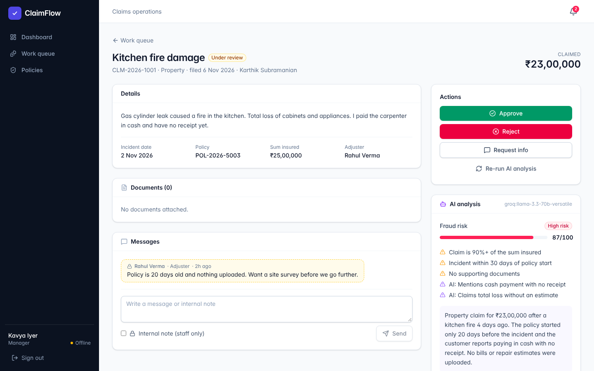
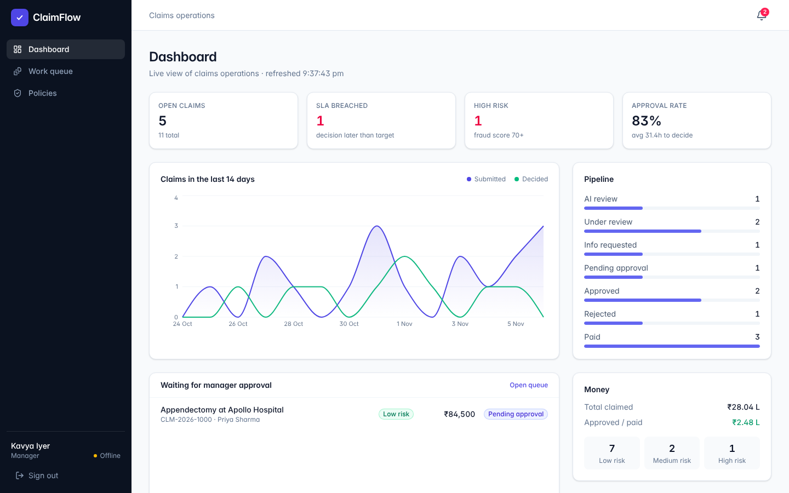
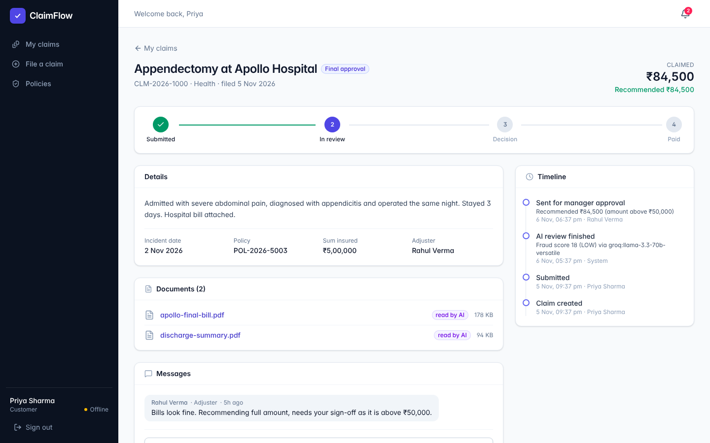
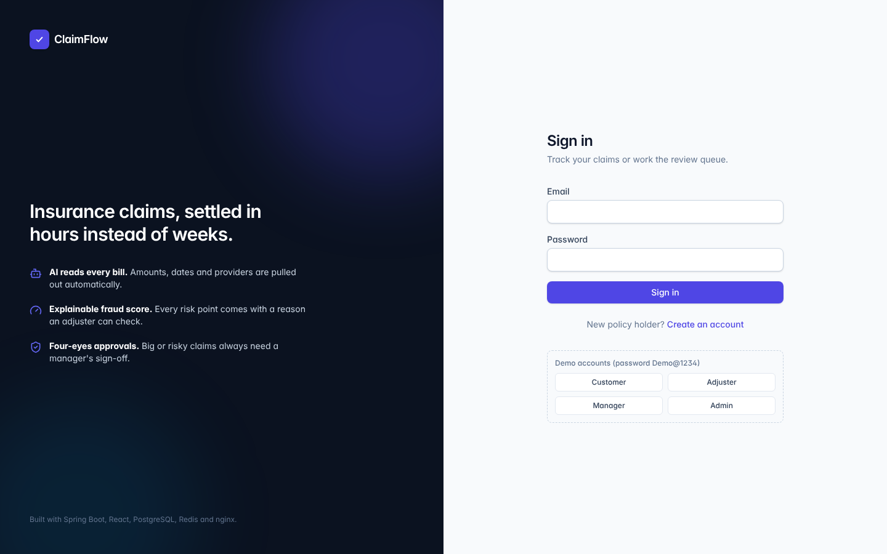

# ClaimFlow

AI-assisted insurance claims processing. A customer files a claim and uploads bills. An AI step reads the documents and scores fraud risk, and an adjuster reviews it. Big or risky claims need a manager's sign-off before payout.

[](https://github.com/DanKan0517-then/claimflow/actions/workflows/ci.yml) [](https://github.com/DanKan0517-then/claimflow/actions/workflows/live-check.yml)

## 🔗 Live demo: **https://claimflow-v9sw.onrender.com**

Log in with any demo account below (password `Demo@1234`), or register as a new customer.
Hosted on Render's free tier, which sleeps after 15 idle minutes. If you're the first visitor in a while, a *"Waking up the server…"* banner shows for about a minute and your login goes through automatically once it's up.

**Stack:** Java 21 · Spring Boot 3 · React 19 + TypeScript · PostgreSQL 16 · Redis 7 · nginx · Docker Compose · Prometheus + Grafana · GitHub Actions · Groq LLM (optional)

```
                         ┌─────────────────────────── Docker network ───────────────────────────┐
  Browser ──HTTPS──▶  nginx  ──least_conn──▶  api-1 (Spring Boot) ──┐                           │
  (React SPA)         │  TLS, rate limits     api-2 (Spring Boot) ──┼──▶ PostgreSQL (data)      │
     ▲                │  static files,             │   ▲            └──▶ Redis (queue, pub/sub,  │
     └──WebSocket─────┘  /ws upgrade               │   │                        cache)          │
                                                   ▼   │                                        │
                                          Groq LLM API (optional)    Prometheus ──▶ Grafana     │
                         └──────────────────────────────────────────────────────────────────────┘
```

| Adjuster review with AI analysis | Manager dashboard |
|---|---|
|  |  |
| **Customer claim tracking** | **Sign in** |
|  |  |

## What it does

| Customer | Adjuster | Manager / Admin |
|---|---|---|
| Files a claim against one of their policies, uploads bills/photos | Works a live queue sorted by SLA or risk | Approves claims above ₹50,000 or with high fraud risk (four-eyes rule) |
| Sees progress: submitted → in review → decision → paid | Sees the AI summary, the bill total it found, and the reasons behind the fraud score | Marks approved claims as paid |
| Answers info requests and uploads more documents | Approves, rejects (with a reason), or asks for more info | Dashboard: SLA breaches, approval rate, workload per adjuster |
| Gets in-app notifications | Leaves internal notes customers never see | Issues policies, manages staff accounts |

## The interesting engineering bits

- **Explicit state machine.** `ClaimStatus` defines every legal transition, and `Claim.transitionTo()` refuses anything else. The UI renders only the buttons from `allowedActions`, which the server computes for the current user.
- **Optimistic locking.** `@Version` on claims, plus an `expectedVersion` check on actions. If two adjusters act on the same claim at once, the second gets a `409` and their screen reloads.
- **Reliable async AI pipeline:**
  - The submission commits first. A `@TransactionalEventListener(AFTER_COMMIT)` then pushes a job onto a Redis list.
  - Both API replicas poll the queue. `RPOP` is atomic, so each job runs exactly once.
  - Failures retry up to 3 times, then go to a dead-letter list.
  - A sweeper re-queues claims stuck in `AI_REVIEW`, for example if a replica died mid-job.
  - The consumer is idempotent, so all of this adds up to at-least-once processing with no duplicate side effects.
- **No DB transaction held during the LLM call.** The pipeline reads in a short transaction, calls the LLM with none open, then writes in a second short transaction with a version check.
- **Explainable fraud score.** `FraudScorer` is plain, unit-tested rules: amount vs sum insured, a new policy, late reporting, repeat claims, a document reused across claims (SHA-256), and bill total vs claimed amount. The LLM can add at most 20 points, always with a stated reason.
- **LLM with fallback.** If `GROQ_API_KEY` is set, Groq (Llama 3.3 70B) extracts bill totals and providers in JSON mode. With no key, or if the call fails, a rule-based extractor takes over, so claims never get stuck.
- **Horizontal scaling.** The API is stateless (JWT), and nginx load-balances two replicas. WebSocket events go through Redis pub/sub, so a change on api-1 reaches a browser connected to api-2. Every response carries `X-Served-By`.
- **nginx as the gateway:**
  - TLS termination
  - per-IP rate limits (login: 10/min)
  - retries on the other replica when one is down
  - security headers and CSP
  - long-cache hashed assets and SPA fallback
  - `/actuator` blocked from the internet
- **Security:**
  - BCrypt passwords and HMAC-signed JWTs
  - role checks with `@PreAuthorize`
  - customers can only ever load their own claims (404, not 403, so IDs don't leak)
  - upload allow-list with magic-byte checks, so a renamed `.exe` is rejected
  - random storage keys (no path traversal)
- **Observability:**
  - Micrometer metrics: request latency histograms, claims submitted, AI calls by provider, queue depth, job outcomes
  - a provisioned Grafana dashboard
  - JSON access logs from nginx, with the request ID passed through to the API logs

## Run it locally

You need Docker.

```bash
cp .env.example .env
docker compose up -d --build
```

Open <http://localhost>. Demo logins all use the password `Demo@1234`:

| Role | Email |
|---|---|
| Customer | `customer@claimflow.dev` |
| Adjuster | `adjuster@claimflow.dev` |
| Manager | `manager@claimflow.dev` |
| Admin | `admin@claimflow.dev` |

- API docs (Swagger): <http://localhost/api/docs>
- Grafana: <http://localhost:3000> (admin / `GRAFANA_PASSWORD`)
- Prometheus: <http://localhost:9090>

For real LLM analysis, put a free Groq key in `.env` as `GROQ_API_KEY` and restart.

### Developing without Docker for the app

```bash
docker compose up -d postgres redis                  # just the infra
cd backend && mvn spring-boot:run \
  -Dspring-boot.run.arguments="--spring.data.redis.password=claimflow-redis --app.seed-demo=true"
cd frontend && npm install && npm run dev            # http://localhost:5173, proxies /api and /ws
```

## Tests

| Layer | What | Command |
|---|---|---|
| Backend unit | State machine, fraud scorer, bill-total extraction, upload validation | `cd backend && mvn test` |
| Backend integration | Full API against real Postgres + Redis (Testcontainers): auth, full claim lifecycle, manager approval, info requests, RBAC, tenant isolation, optimistic-lock conflicts, file spoofing | `cd backend && mvn verify` |
| Frontend | Formatting, components, login flow | `cd frontend && npm test` |
| System (E2E) | Whole stack in Docker through nginx: seeding, AI worker, new claim → approval, load balancing across both replicas, rate limiting, actuator hidden | `deploy/smoke-test.sh` |
| Load | k6, 30 virtual users for 45s, p95 thresholds | see `loadtest/` |

GitHub Actions runs all of it on every push: backend, then frontend, then the full Docker stack with the k6 load test and smoke test.

Latest CI load test (GitHub runner, 2 API replicas behind nginx, 30 virtual users): **6,284 requests, 0 failures, p95 latency 49 ms**.

## Deploy

**Live demo (Render, free tier):** <https://claimflow-v9sw.onrender.com>. Defined in [`render.yaml`](render.yaml) and [`Dockerfile.render`](Dockerfile.render): one container with nginx (gateway + React) in front of the Spring Boot API, plus Render Postgres and Key Value (Redis), all in Singapore. It redeploys on every push to `main`.

nginx and the API share a container on the demo because free services sleep when idle, and one service wakes as a unit; two would each need waking. The frontend retries through the cold start and shows a banner meanwhile. Free tier limits: one API instance, and uploaded files are cleared on restart.

**Full production setup (your own VM):** see [docs/DEPLOYMENT.md](docs/DEPLOYMENT.md). In short, use a free Oracle Cloud VM, a domain, and `deploy/deploy.sh your.domain you@email`, which gets a Let's Encrypt certificate and starts everything behind nginx on 443.

## Docs

- [Requirements (SRS)](docs/SRS.md)
- [Architecture, ER diagram, sequence diagrams](docs/ARCHITECTURE.md)
- [Design decisions (ADRs)](docs/adr/)
- [Deployment](docs/DEPLOYMENT.md) and [Runbook](docs/RUNBOOK.md)

## Project layout

```
backend/     Spring Boot API (auth, user, policy, claim, document, ai, events, notification, analytics, audit)
frontend/    React + TypeScript + Tailwind SPA
nginx/       Gateway config (local HTTP + production HTTPS) and the image that bundles the React build
monitoring/  Prometheus scrape config, Grafana datasource + dashboard
loadtest/    k6 script
deploy/      deploy, backup and smoke-test scripts
docs/        SRS, architecture, ADRs, runbook
```
