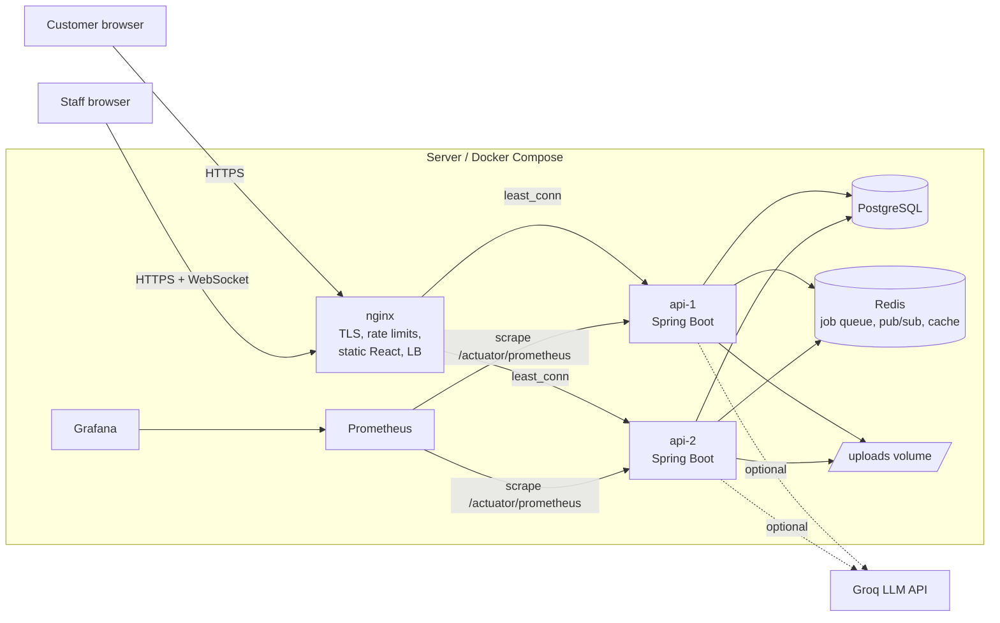
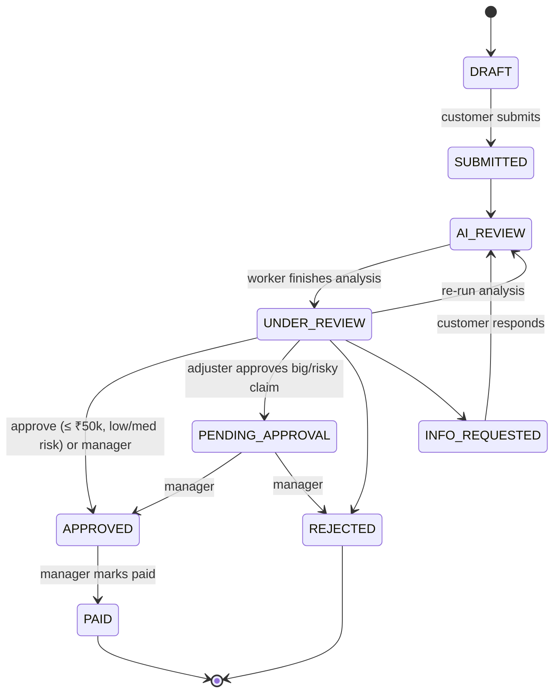

# Architecture

## System context



## Backend modules (one deployable, clear package boundaries)

| Package | Responsibility |
|---|---|
| `security` | JWT issue/verify, filter, password hashing, CORS |
| `user` | Registration, login, staff management |
| `policy` | Policies and coverage checks |
| `claim` | Claim entity + state machine, workflow rules, queries, access control |
| `document` | Upload validation, storage, text extraction (PDFBox) |
| `ai` | Analysis pipeline, LLM client, rule-based fallback, fraud scorer, Redis job queue |
| `events` | Redis pub/sub + WebSocket fan-out |
| `notification` | In-app notifications |
| `analytics` | Dashboard aggregates (cached in Redis) |
| `audit` | Append-only audit trail |

Why one deployable rather than microservices: see [ADR-001](adr/001-modular-monolith.md).

## Data model

```mermaid
erDiagram
    USERS ||--o{ POLICIES : holds
    USERS ||--o{ CLAIMS : files
    USERS ||--o{ CLAIMS : "assigned to"
    POLICIES ||--o{ CLAIMS : covers
    CLAIMS ||--o{ CLAIM_DOCUMENTS : has
    CLAIMS ||--o{ CLAIM_COMMENTS : has
    CLAIMS ||--o{ AUDIT_LOG : records
    USERS ||--o{ NOTIFICATIONS : receives

    USERS { bigint id PK; varchar email UK; varchar password_hash; varchar role; bool active }
    POLICIES { bigint id PK; varchar policy_number UK; bigint holder_id FK; varchar type; numeric sum_insured; date start_date; date end_date; varchar status }
    CLAIMS { bigint id PK; varchar claim_number UK; bigint policy_id FK; bigint customer_id FK; bigint assigned_adjuster_id FK; varchar status; numeric claimed_amount; numeric approved_amount; int fraud_score; text fraud_flags; text ai_summary; timestamptz sla_due_at; bigint version }
    CLAIM_DOCUMENTS { bigint id PK; bigint claim_id FK; varchar sha256; varchar storage_key; text extracted_text }
    CLAIM_COMMENTS { bigint id PK; bigint claim_id FK; bigint author_id FK; text body; bool internal }
    AUDIT_LOG { bigint id PK; bigint claim_id FK; bigint actor_id FK; varchar action; varchar from_status; varchar to_status }
    NOTIFICATIONS { bigint id PK; bigint user_id FK; bigint claim_id FK; varchar message; bool read }
```

Indexes cover every foreign key plus `claims(status)` and `claims(created_at)` (queue filters and dashboard). Schema changes go through Flyway; Hibernate only validates.

## Claim state machine



## Submitting a claim

```mermaid
sequenceDiagram
    participant B as Browser
    participant N as nginx
    participant A as api-1
    participant DB as Postgres
    participant R as Redis
    participant W as api-2 (worker)
    participant L as Groq LLM

    B->>N: POST /api/claims/42/submit
    N->>A: proxy (least_conn)
    A->>DB: BEGIN; DRAFT→SUBMITTED→AI_REVIEW; audit; COMMIT
    A-->>R: after commit: LPUSH jobs:analysis 42
    A-->>R: after commit: PUBLISH claim-events
    A->>B: 200 (status AI_REVIEW)
    R-->>A: event → WebSocket clients on api-1
    R-->>W: event → WebSocket clients on api-2
    W->>R: RPOP jobs:analysis → 42
    W->>DB: short read tx (claim, policy, docs)
    W->>L: analyse (no tx open)
    L->>W: JSON summary, bill total, risk reasons
    W->>W: FraudScorer rules + AI points
    W->>DB: tx: check version, save results, AI_REVIEW→UNDER_REVIEW, assign adjuster
    W-->>R: PUBLISH claim-events
    R-->>B: (via whichever replica holds the socket) claim updated
```

## Failure handling

| Failure | What happens |
|---|---|
| One API replica dies | nginx marks it failed after 3 errors, retries idempotent requests on the other one; WebSocket clients reconnect with backoff |
| LLM down / slow (30s timeout) | Rule-based analyser is used, metric `claimflow_ai_calls{outcome="fallback"}` increments |
| Redis down at submit time | Claim is committed in `AI_REVIEW`; sweeper re-queues it within ~3 minutes of Redis returning |
| Worker crashes mid-job | Same sweeper; the consumer is idempotent so a duplicate job is a no-op |
| Job keeps failing | 3 attempts, then `claimflow:jobs:analysis:dead` for inspection |
| Two users act on one claim | `@Version` → 409 → UI reloads the latest version |
| Login brute force | nginx returns 429 after 10/min (+burst) per IP |
